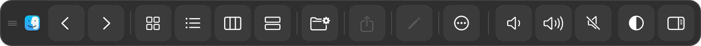

# TouchBar — 跟随前台 App 的浮动工具栏

一条浮在屏幕上的工具条，内容**来自前台 App 自己的工具栏**：按钮、图标、启用状态、分组都照搬，点一下就是那个 App 的真实动作（走 `AXPress`，不是模拟快捷键）。

macOS 的 Touch Bar 硬件已经停产，但「工具条跟着当前 App 变」这件事对触控屏依然好用——尤其是：

- 支持触控的新款 MacBook Pro
- 外接触控显示器
- 把平板当 Mac 副屏（DP-in）的场景

## 它长什么样



收纳到侧边后是一条细标签，点它展开：


- 左边是拖动把手和前台 App 的图标
- 中间是它自己的工具栏按钮，按原分组画分隔线
- 右边是音量/静音、透明度、收纳

## 功能

| 能力 | 说明 |
| --- | --- |
| 跟随前台 App | 切 App 后 0.6 秒内整条重建 |
| 真实动作 | 点按钮走 `AXPress`，由 App 自己决定做什么（返回就回它的历史） |
| 状态同步 | 按钮的可用/禁用跟着 App 走（没选中文件时「共享」是灰的） |
| 图标映射 | 按语义标签映射到 SF Symbols，中英文都认 |
| 移动 | 拖最左边的把手或空白处 |
| 收纳 | 拖到边缘 24px 内松手自动吸附成细标签，点标签展开；也可以点按钮收纳到最近的边 |
| 透明度 | 100% / 85% / 70% / 55% 循环切换 |
| 记忆 | 位置、收纳边、透明度存在 `~/Library/Application Support/TouchBar/state.json` |

## 安装

下载 `TouchBar-<版本>.dmg`，拖进「应用程序」即可。App 常驻菜单栏，不占 Dock。

首次打开：

1. 被 Gatekeeper 拦下 → 系统设置 → 隐私与安全性 → 安全性 → 「仍要打开」
2. 授权辅助功能：系统设置 → 隐私与安全性 → **辅助功能**（macOS 27.3 里叫「设备控制和数据访问」）→ 把 TouchBar 打开 → 退出重开

没有辅助功能权限时，工具条能显示，但读不到别的 App 的工具栏。

## 作为插件

同一个代码库也能打成插件包，由宿主 App 加载（API v1）：

```python
mod = <import touchbar_plugin>
ctl = mod.create(on_hide=..., log=...)
ctl.show() / ctl.hide() / ctl.toggle() / ctl.is_visible
ctl.tick()      # 宿主定时器驱动
ctl.close()
```

插件包不包含菜单栏入口和 App bundle，权限由宿主进程提供。

```bash
python3 tools/make_plugin_zip.py --version 0.1.0   # -> dist-pyi/touchbar-plugin-0.1.0.zip
```

## 已知限制

- **只对暴露了 AX 工具栏的 App 有效。** 访达、日历、Word、Safari 这类原生 App 没问题；很多 Electron 应用（Figma、VS Code）不暴露工具栏，这时只显示「无工具栏」。
- **读不到 App 自己画的 Touch Bar 内容。** 当年适配 Touch Bar 的 App（包括一些游戏）是把按钮直接画给系统 TouchBarServer 的，第三方拿不到；`DFRTouchBarSimulator` 那条私有路线在 macOS 27 上已经不出画面（实测：模拟器和显示流都能创建，但 0 帧、事件回传 false）。
- 工具栏里没有对应图标的按钮退回文字显示。
- 亮度不在这条上：外接屏的背光归显示器自己管，macOS 改不了。

## 构建

```bash
./build_app.sh     # -> dist-pyi/TouchBar.app（ad-hoc 签名）
./make_dmg.sh      # -> dist-pyi/TouchBar-<版本>.dmg
python3 tools/make_plugin_zip.py
```

需要 Python 3.12 + PyObjC；`build_app.sh` 会在缺环境时用 `uv` 建一个 `.venv`。

## 许可

MIT
